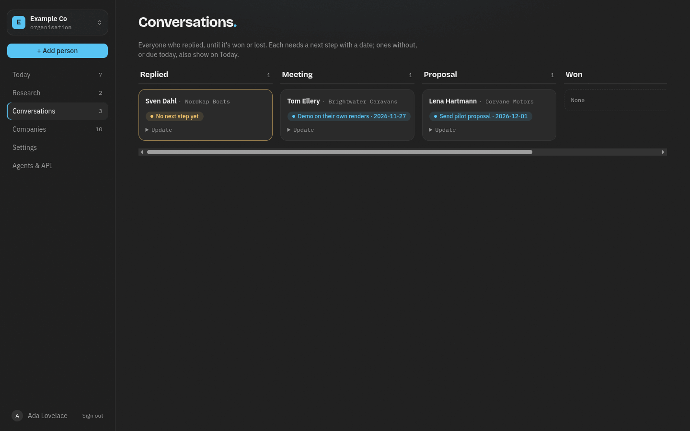
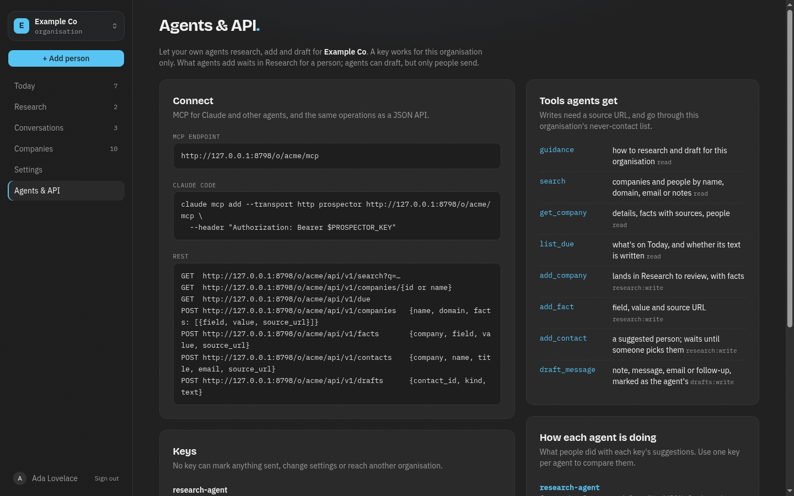

# Prospector

**A self-hosted, account-based prospecting workbench for small teams selling to a few hundred named accounts.**

People and agents research companies, keeping a source link for every fact. People then work one daily queue across LinkedIn, email and phone, from first touch to deal. Agents research and draft over MCP; only people send.

One binary, one database (SQLite or Postgres), several organisations per login.

[](https://github.com/shutthegoatup/prospector/actions/workflows/ci.yml)
[](https://github.com/shutthegoatup/prospector/releases/latest)


<sub>Screenshots use invented companies and people.</sub>

## What it does

### Today: one queue, best first

Everything due, in this order:
1. conversations needing a next step;
2. calls where it's office hours for the contact, from their phone number's time zone;
3. LinkedIn messages, emails and follow-ups;
4. LinkedIn adds.

The side panel says what to do now, and counts the last week's touches, replies and meetings.

On LinkedIn adds, `o` opens the profile and copies the note, `a` marks it added and `s` skips it. That's the whole loop for working through a list:


### Research: facts with sources

Companies found by agents, imports and people wait here to be qualified or rejected. Every fact keeps the link it came from. "Pick" moves a suggested person into outreach, with a note from your template.


### Conversations: replies to deals

Replies move across a board: replied, meeting, proposal, won, lost. Each needs a next step with a date. Ones without, or due today, come back on Today.



### Agents and API

Each organisation has an MCP endpoint and a REST API, with scoped keys. Agents can search, add companies, facts and suggested contacts, and draft messages. They can't send anything or change settings.



### Also

- **Companies:** search, plus each company's people, facts and full history: who did what, people and agents alike.
- **Add person:** paste a LinkedIn profile link and the name fills in. A bookmarklet opens the same form pre-filled from the profile you're viewing.
- **Settings, per organisation:** waits between steps, connection-note template, call-script pitch, never-contact list and team. Each member sets their own caller name and signature.
- **Several organisations per login:** each has its own prospects, wording, team and keys, and none can see another's.

## Run it

```sh
go install github.com/shutthegoatup/prospector@latest   # or download a release
prospector org add acme "Acme"
prospector user add you@example.com "Your Name"          # asks for a password
prospector member add acme you@example.com owner
prospector serve                                          # http://127.0.0.1:8766
```

| Variable | Meaning |
|---|---|
| `DATABASE_URL` | A `postgres://` URL or a SQLite file path (default `prospector.sqlite`) |
| `PORT` | Listen on `:PORT` instead of `127.0.0.1:8766` |
| `TZ` | The time zone "today" is counted in |
| `PROSPECTOR_ORG` | Default organisation for CLI commands (`--org=` overrides it) |
| `PROSPECTOR_KEY` | API key for `push` and `pull` |

**Before exposing it beyond your machine:**
- Put it behind HTTPS. Copy to clipboard needs a secure page, and the session cookie is marked Secure on HTTPS. A proxy in front must send `X-Forwarded-Proto: https`, or the cookie isn't marked Secure.
- Repeated wrong passwords for one email are slowed, up to a minute between tries.
- Every page needs a sign-in, and every browser POST must be JSON, which blocks cross-site form posts.

There's a Dockerfile for container hosting.

## Agents: MCP and REST

Each organisation has an MCP endpoint at `/o/<slug>/mcp` (streamable HTTP) and a JSON API at `/o/<slug>/api/v1/…`. Create keys on the Agents & API page or with `prospector key add <org> <name> <scope>…`.

| Scope | Allows |
|---|---|
| `read` | `search`, `get_company`, `list_due` |
| `research:write` | `add_company`, `add_fact`, `add_contact`; these wait in Research for a person |
| `drafts:write` | `draft_message`, shown as written by the agent |
| `import` | `push` and `pull` |
| `outcomes:write` | `mark`: record an outcome (sent, accepted, called, replied, declined, hold), shown as the agent's |

- **What no key can do:** send anything, change settings, or see another organisation. A key with `outcomes:write` can record what happened (sent, accepted, replied, declined…); each mark shows as the agent's, with its note, on Today and in the company's history.
- **Writes are checked:** every fact and contact needs a source URL, and the never-contact list applies.

```sh
claude mcp add --transport http prospector https://<host>/o/<slug>/mcp --header "Authorization: Bearer $PROSPECTOR_KEY"
```

## Importing drafts from markdown

`prospector import --org=<slug> --dir=<folder>` reads this layout. `push` sends the same data to a running server.

- `leads/prospects.csv`: one company per row. Columns: `name`, `segment`, `country`, `website`, `configurator_url`, `fit_reason`, `buyer_role`, `priority`, `configurator_built_by`.
- `leads/outreach/NN-name.md`: one prospect per file, with a `| Primary | Name | Title |` contacts row and sections `## LinkedIn note`, `## Email` (with `**Subject:**`), `## Channel` and `## Follow-up`.
- `leads/outreach/*.md`: several prospects per file, under a `| Fit | Maker | Contact | LinkedIn | Email |` send list, each with a `**LinkedIn note (N)**` block.
- `leads/outreach/sent-log.md`: people listed under a `## YYYY-MM-DD` heading are marked added on LinkedIn that day.

`--own-domain=example.com` leaves links to your own site out of the source lists. The files in `testdata/` show the format, with invented companies and people.

Re-importing refreshes text from the files but never clears a date or edit recorded in the app.

## Develop

```sh
go test ./...                                            # SQLite
PROSPECTOR_TEST_PG=postgres://… go test -p 1 ./...      # an empty, disposable Postgres database; tables are dropped
go tool templ generate                                   # after editing *.templ
go tool shadcn-templ add <component>                     # UI components (shadcn/ui for templ)
node build-css.mjs <node_modules with tailwindcss v4>   # or the standalone tailwindcss CLI
```

`assets/css/output.css`, the script bundle and `*_templ.go` are committed, so a plain `go build` needs neither Node nor Tailwind.

## Releases

Every push to `main` that passes CI is released as the next patch version (`v0.1.1`, `v0.1.2`, …) by `ci.yml`. Push a `v*` tag by hand for a minor or major bump; `release.yml` builds that one. Each release has binaries for Linux and macOS (amd64 and arm64) and `checksums.txt`. `prospector version` prints the version a binary was built from.

## Data

The repository holds code and invented test fixtures only. Databases, snapshots and exports contain the people you prospect, so `.gitignore` keeps `*.sqlite`, `*.sql`, `*.dump` and `*.csv` out, apart from `testdata/`.
