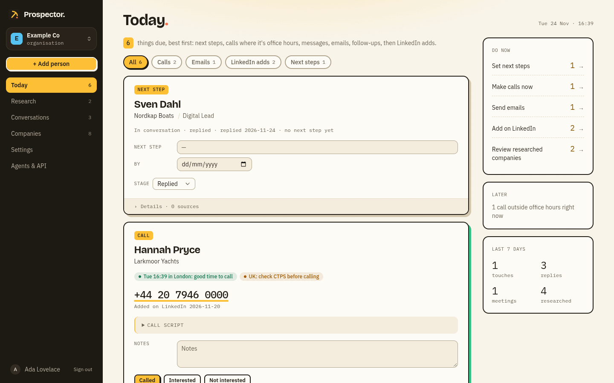
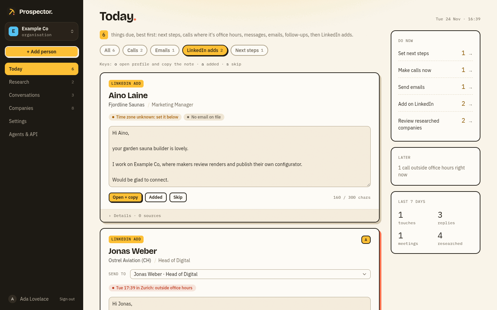
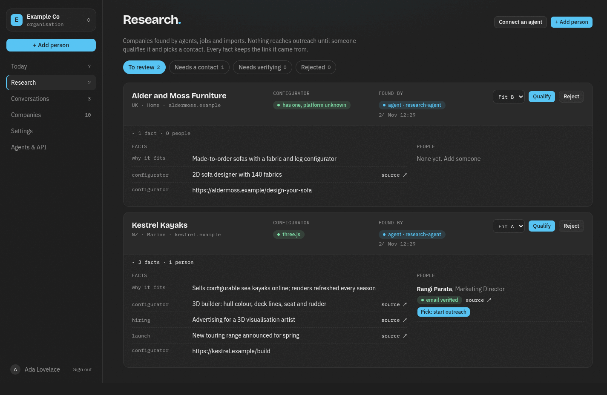

# Prospector

**A self-hosted, account-based prospecting workbench for small teams selling to a few hundred named accounts.**

People and agents research companies, keeping a source link for every fact. People then work one daily queue across LinkedIn, email and phone, from first touch to deal. Agents research and draft over MCP; only people send.

One binary, one database (SQLite or Postgres), several organisations per login.

[](https://github.com/shutthegoatup/prospector/actions/workflows/ci.yml)
[](https://github.com/shutthegoatup/prospector/releases/latest)



<sub>Screenshots use invented companies and people.</sub>

## What it does

### Today: one queue, best first

Everything due, in this order:
1. conversations needing a next step;
2. calls where it's office hours for the contact, from their phone number's time zone;
3. LinkedIn messages, emails and follow-ups;
4. LinkedIn adds.

The side panel says what to do now, and counts the last week's touches, replies and meetings.

On LinkedIn adds, `o` opens the profile and copies the note, `a` marks it added and `s` skips it. That's the whole loop for working through a list:



### Research: facts with sources

Companies found by agents, imports and people wait here to be qualified or rejected. Every fact keeps the link it came from. "Pick" moves a suggested person into outreach, with a note from your template. Rejecting a company takes its people out of the outreach queues on Today; qualifying it again brings them back as they were. Someone already in a conversation stays on the board.



### Tasks: write a brief, hand it to an agent

Write what you want found. An agent picks the task up and what it finds waits in Research, tied to the task. Anyone can ask for more later, and a different agent can carry on: it is shown the brief, every request, what has already been found and what a person rejected, and the notes earlier agents left on what they skipped.

Your own agent starts on a task from the prompt on its page (clients that show MCP prompts as commands have it as `work_task`). Or Prospector works it with its own agent: see [Prospector's own agent](#prospectors-own-agent).

A task shows as waiting, being worked on, or done. Nothing an agent says while working is stored: its status and results are read from what it added. Agents often stop without saying so, so each request shows what has been added since it was asked, and you can mark one done or reopen it yourself.

An agent that picks a task up is kept the oldest open request no other agent has, so two agents started on the same task take different requests. The claim lasts 15 minutes, is renewed by everything the agent adds for the task, and ends when the request is done. It lapses by itself if the agent stops. It is advice to other agents: what anyone adds is still accepted.

### Conversations: replies to deals

Replies move across a board: replied, meeting, proposal, won, lost. Each needs a next step with a date. Ones without, or due today, come back on Today.


### Agents and API

Each organisation has an MCP endpoint and a REST API, with scoped keys. Agents can search, add companies, facts and suggested contacts, and draft messages. They can't send anything or change settings.


### Also

- **Companies:** search, plus each company's people, facts and full history: who did what, people and agents alike.
- **Take everything with you:** an owner can download all the organisation holds from Settings (or `prospector export-org <file>`): companies, people, facts, enquiries, history, settings and who has access, as one JSON file. It holds no passwords (a mail server's included), API keys or sign-on secrets, and nothing that identifies people you erased.
- **Export a person:** when someone asks what you hold on them, an owner can download it from their company's page (or `prospector export-person <name> <file>`): their details, drafts, notes, the facts recorded against them, what they wrote to you and their history. The history names the teammates and agents who acted, so read it through before you send it on. The export is itself noted in the history.
- **Erase a person:** an owner can erase someone from their company's page (or `prospector erase <name>`) when they ask to be forgotten. Their details, drafts, notes and facts are deleted, the history keeps only that something happened and when, and an import, a restore or an agent can't add them again. A row that names several people goes whole. Agents' notes about their company, and on any task that touched it, are deleted too, since free text can't be searched for a name. Company facts and other people's notes that mention them, the briefs and requests people wrote on tasks, your own lead files and database backups aren't touched: take them out there too.
- **Add person:** paste a LinkedIn profile link and the name fills in. A bookmarklet opens the same form pre-filled from the profile you're viewing.
- **Settings, per organisation:** waits between steps, connection-note template, call-script pitch, never-contact list, what you look for at a company and team. Each member sets their own caller name and signature.
- **What you look for:** each organisation names the things that make a company a fit, one per line in Settings, such as `configurator: a product configurator on their site` or `careers_page: a jobs page`. Agents are told the list and record each as a fact under that name; Research and the company page show which ones a company has.
- **Several organisations per login:** each has its own prospects, wording, team and keys, and none can see another's.

## Run it

```sh
go install github.com/shutthegoatup/prospector@latest   # or download a release
prospector org add acme "Acme"
prospector user add you@example.com "Your Name"          # asks for a password
prospector member add acme you@example.com owner
prospector serve                                          # http://127.0.0.1:8766
```

| Variable | Meaning |
|---|---|
| `DATABASE_URL` | A `postgres://` URL or a SQLite file path (default `prospector.sqlite`) |
| `PORT` | Listen on `:PORT` instead of `127.0.0.1:8766` |
| `PROSPECTOR_URL` | The address people reach it at, e.g. `https://prospector.example.com`. With an `https://` address the session cookie is always marked Secure, and links shown in the app use this address. Set it if a proxy in front changes the `Host` header |
| `SMTP_ADDR`, `MAIL_FROM` | The mail server the app's own mail leaves through, e.g. `smtp.example.com:587` and `Prospector <prospector@example.com>`. Set both or neither; see [Mail](#mail) |
| `SMTP_USERNAME`, `SMTP_PASSWORD` | What that server asks for, if anything |
| `PROSPECTOR_SECRET_KEYS` | The server's secret keys, newest first: `2:<64 hex>,1:<64 hex>`. Needed for an organisation's single sign-on and for a mail server of its own (see [Secret keys](#secret-keys)) |
| `PROSPECTOR_GOOGLE_CLIENT_ID`, `PROSPECTOR_GOOGLE_CLIENT_SECRET` | Offer "Continue with Google" on the sign-in page. The same pair exists for `MICROSOFT` and `LINKEDIN`. Each needs `PROSPECTOR_URL` (see [Signing in](#signing-in)) |
| `TZ` | The time zone "today" is counted in |
| `PROSPECTOR_ORG` | Default organisation for CLI commands (`--org=` overrides it) |
| `PROSPECTOR_KEY` | API key for `push` and `pull` |

Search uses a trigram index. On Postgres that needs the `pg_trgm` extension, which is created on start-up if the database user may; without it search still works, by scanning.

**Before exposing it beyond your machine:**
- Put it behind HTTPS. Copy to clipboard needs a secure page, and the session cookie is marked Secure on HTTPS. Set `PROSPECTOR_URL` to the `https://` address so the cookie is always marked Secure; without it, that depends on the proxy sending `X-Forwarded-Proto: https`.
- Pages carry a Content-Security-Policy that allows only what the app itself serves. The typefaces are bundled, so a visitor's browser contacts no other site.
- A request's body has five minutes to arrive and its answer two minutes to be read, so a stalled client doesn't hold a connection open. An agent's MCP stream, once its key is accepted, stays open.
- Repeated wrong passwords for one email are slowed, up to a minute between tries. A browser that has signed in to that account before is counted separately, so someone guessing elsewhere can't hold its owner up.
- An owner adds and removes members in Settings. Removing someone ends their sign-in access to that organisation; their account, and other organisations, are untouched. API keys they created keep working until revoked on the Agents page. If the organisation lets people join through its single sign-on, someone removed here joins again while its provider still lets them in: remove them there too.
- Someone added from Settings gets a first password that the person adding them sees; they are made to choose their own the first time they sign in.
- With [mail](#mail) set up, whoever reads a member's mailbox can choose that member's password. Without it there is no reset but `prospector user password`.
- Members change their own password in Settings, which signs out their other sessions. `prospector user password` signs them out everywhere.
- Every page needs a sign-in except the sign-in pages and the front page at `/`, which describes Prospector to a signed-out visitor and shows nothing from your data. The single sign-on page does name the organisations that have verified an email domain to anyone who types an address at it. Every browser POST must be JSON, which blocks cross-site form posts, and a request that a browser marks as coming from another site is refused, sign-in and sign-out included.
- The one exception is the enquiry route, `/o/<slug>/intake`, which exists to be posted to from your own sites. It answers only the sites an owner lists in Settings, reads no session, and can add an enquiry and nothing else. With no sites listed it refuses everything. The front page's own contact form posts there too, for the `prospector` organisation. A server with `PROSPECTOR_URL` set makes that organisation with its own address listed, so there the route is open from the first start: up to 300 enquiries an hour are kept, read by nobody until someone is added to it. Remove the address from its sites if you don't want the form.

There's a Dockerfile for container hosting.

## Mail

The app sends two kinds of mail, both to its own members. It never sends outreach: people do that from their own mailbox.

- **Password resets.** The sign-in page offers "Forgot your password?", which emails a link that lasts an hour and works once.
- **Invitations.** Someone an owner adds is emailed a link to choose their password, good for 7 days, instead of the owner being shown a first password to pass on.

Both need `SMTP_ADDR`, `MAIL_FROM` and `PROSPECTOR_URL`: a link is only ever built from the address you gave, never from what a request claims. With any of them missing there is no reset and first passwords are shown as before. `prospector mail test you@example.com` sends a message through the server you set.

Any SMTP submission service that takes a username and password (`AUTH PLAIN`) works, a transactional mail provider's included. Mail goes over TLS (STARTTLS, or implicit TLS on port 465) or not at all; only a server on the same machine is spoken to in the clear.

**An organisation can use a server of its own**, set by an owner under Settings → Outgoing mail. Invitations to that organisation then leave through it, from its address. Resets belong to the account, not to an organisation, so they always use the app's. The password is kept sealed under the server's [secret key](#secret-keys), which must be set first, and is never shown again. The server must be on port 587, 465, 2525 or 25. It carries an invitation only for an account that the invitation itself creates: whoever runs a mail server reads what passes through it, so someone who already has an account, and hasn't chosen a password yet, is sent the link by the app's own server or not at all. A second invitation to the same person waits five minutes and ends the first.

A reset link gives a password to an account that had none because it signs in through a provider. An organisation that requires its single sign-on refuses that password as it does any other.

## Signing in

Everyone can sign in with an email and password. Two more ways can be turned on, both OpenID Connect, and both needing `PROSPECTOR_URL`: the provider sends people back to `<PROSPECTOR_URL>/login/callback`, which is the redirect URI to register with it.

### Google, Microsoft and LinkedIn, for the whole server

Whoever runs the server registers an app with the provider and sets its `PROSPECTOR_<PROVIDER>_CLIENT_ID` and `_CLIENT_SECRET`. The sign-in page then offers it to everybody.

- It signs in people who already have an account, matched the first time by an email address the provider has verified and after that by the provider's own ID for them. It never creates an account.
- Microsoft's `email` claim is whatever a tenant's admin typed, so an address counts only when the token carries `xms_edov`. Add `xms_edov` to the ID token's optional claims in the app registration, or nobody can be matched.
- LinkedIn is asked without PKCE or a nonce, which it doesn't document.

### An organisation's own single sign-on

An owner sets this up in Settings, for Okta, Entra ID, Google Workspace or any other OpenID Connect provider:

1. **Add the email domains that are yours** and prove each with the DNS TXT record Settings shows. The provider is believed only for addresses at a verified domain, matched whole.
2. **Enter the issuer, client ID and client secret.** The issuer is read before anything is saved. The secret is kept sealed under the server's [secret key](#secret-keys), which must be set first, and is never shown again; it has to be typed again when the issuer or client ID changes.
3. Optionally **require it**: members at your domains can no longer open the organisation on a password. Owners still can, so a broken provider can be put right, and so can members at other domains, whom your provider couldn't sign in. API keys are unaffected. If no owner can get in, `prospector sso off <org>` stops requiring it.
4. Optionally **let people join**: anyone at your domains becomes a member, never an owner, the first time they sign in. Without this, the provider signs in only people an owner has already added.

People start from "Use your organisation's single sign-on" on the sign-in page and give their work address.

- A session that began at an organisation's provider opens that organisation only, since the provider vouches for nothing else. Someone already signed in who goes through it keeps their session.
- Going through the provider counts for a day, then it is asked again. Someone the provider has turned away is out within that day; to end it sooner, remove them from the team.
- With Google as the provider, the account must also be in a Workspace for that domain (`hd`). An issuer that signs in every tenant under one registration, such as Microsoft's `/common`, is refused: use your own tenant's.
- An issuer must be `https` at a public address; one inside the server's network is never contacted.
- Someone invited with a first password who arrives through a provider instead isn't asked to change it: that password stops working.
- Each change to the connection, and each person who joins through it, is recorded in the organisation's events with who and when. SAML and SCIM aren't supported.

## Secret keys

`PROSPECTOR_SECRET_KEYS` holds the server's master keys, each with a version: `1:<64 hex characters>`. `prospector secret-key` prints a first entry, and `prospector secret-key 2` the one to replace it with. It is the only secret of its own the server is given.

- **A master key is never used directly.** Each job gets its own key derived from it with HKDF-SHA256 (RFC 5869).
- **What it seals** is each organisation's single sign-on client secret and the password of its own mail server, each stored as a compact JWE (RFC 7516, `dir` with `A256GCM`) whose `kid` is the key's version.
- **What it keys** is how a session and an API key are found: by an HMAC of the token under the server's key, where without a key it is the token's plain hash. Someone who can write to the database but hasn't the key can't mint a session. An API key is not protected that far: one made before the server had a key is still accepted by its plain hash, because an agent can't sign in again, so a row written with a plain hash is accepted too.
- **What it signs** is the cookie that carries a sign-in to a provider and back.
- **Passwords** are bcrypt hashes and take no part: a key mixed into them couldn't be replaced without everyone choosing a new password.
- **Giving a server its first key signs everybody out**, once. API keys keep working: each is found by its plain hash and moves to the keyed one the first time it is used. That move is one-way: going back to a release from before it, or running a server with no key beside one that has, signs everybody out again and refuses every API key that has been used since, which then have to be made again.
- **Without it** the server runs, but no client secret can be saved, so no new single sign-on connection. A secret stored in clear by an earlier release still works, its connection's other settings can still be changed, and it is sealed the first time the server starts with a key. After that, going back to any release from before sealing breaks those sign-ins until each owner types the secret again.
- **Back it up apart from the database.** A database without the key can't read the secrets; a key that is lost takes them with it, and each owner types theirs again.

The first key in the list seals and signs; every key in the list opens and verifies. A new key always gets a new, higher version: one swapped in under an old version opens nothing, and the server says so in its log when it starts. Only `prospector serve` reads the keys, so a mistyped one doesn't stop `sso off` or `user password`. To replace a key:

1. **Publish.** Add the new key after the current one, `1:<old>,2:<new>`, and restart. Needed only when several servers share the database, so each can open version 2 before any seals with it.
2. **Promote.** Put the new key first, `2:<new>,1:<old>`, and restart. At start-up every stored secret is sealed again under the new key. A server still listing the old key first leaves those alone.
3. **Retire.** Once every server has been restarted with the new key first and its log says `none is under a key older than 2`, remove the old key and restart. Sign-ins in flight under the old key, at most ten minutes old, have to start again. Sessions and API keys move to the new key as they are used; the log counts the API keys that haven't yet, and one whose key is removed first stops working and has to be made again.

## Agents: MCP and REST

Each organisation has an MCP endpoint at `/o/<slug>/mcp` (streamable HTTP) and a JSON API at `/o/<slug>/api/v1/…`. Create keys on the Agents & API page or with `prospector key add <org> <name> <scope>…`.

| Scope | Allows |
|---|---|
| `read` | `search`, `get_company`, `list_due`, `list_tasks`, `get_task` |
| `research:write` | `add_company`, `add_fact`, `add_contact`; these wait in Research for a person. `task_note` and `finish_request` on tasks |
| `drafts:write` | `draft_message`, shown as written by the agent |
| `import` | `push` and `pull`: a full sync, for a person's own files rather than an agent |
| `outcomes:write` | `mark`: record an outcome (sent, accepted, called, replied, declined, hold), shown as the agent's |
| `enquiries:write` | `POST /api/v1/enquiries`: record an enquiry or sign-up from your own product or site backend |

- **What no key can do:** send anything, change settings, or see another organisation. A key with `outcomes:write` can record what happened (sent, accepted, replied, declined…); each mark shows as the agent's, with its note, on Today and in the company's history. `import` is the one scope that skips review: it puts people from your own files straight into outreach and marks those in `sent-log.md` as added.
- **Writes are checked:** every fact and contact an agent adds needs a source URL. The never-contact list applies to agents, imports and edits alike: an import that would bring in an address on it is refused whole, though people already stored stay as they are. Someone already stored who falls under the list drops out of the outreach queues on Today and the agents' due list until the entry is removed, and Settings names them; a person who has already replied stays in Conversations. An entry is a domain, an email address or a LinkedIn profile link, matched whole: a company name or a loose word matches nobody.
- **Doing it twice is safe:** an agent that runs again, or a second agent on the same company, adds nothing that is already there, and the reply says `existed`. A company matches on its name, or on its domain when one company alone has it; a fact on its field, wording and source page; a person on their profile, address or name at that company. The same fact worded differently is still a second fact, and an email, phone or profile found for a person already there is not filled in: it waits under **Details to check** in Research, and on the company's page, for someone to accept or dismiss. One that was dismissed isn't raised again, and details sent under a different name from the person they matched are left out, since they may be a colleague's. An agent's draft is refused once a person has edited that text or it has gone out.
- **Agents see what came before:** `get_company` returns the company's last 20 history entries (who, what, when, and for whom) and each person's next step, and it and `search` say which agent last changed a company and whether that was the same key. Only writes show: an agent that has looked but not yet added anything is invisible to the others. Free text from the history, such as the note on a mark, is left out.
- **Sessions:** an MCP session works only with the key that opened it.

```sh
claude mcp add --transport http prospector https://<host>/o/<slug>/mcp --header "Authorization: Bearer $PROSPECTOR_KEY"
```

## Prospector's own agent

An organisation can have Prospector work its tasks with a model of its choosing. An owner sets it up in Settings → Prospector's agent:

- **Endpoint:** any OpenAI-compatible endpoint: its base URL (the one `/models` and `/chat/completions` are under), an API key and a model. Saving reads the endpoint's model list to choose from, and a router model that picks one per request works as well as a single model. OpenRouter's base URL is `https://openrouter.ai/api/v1`; an LLM gateway of your own works the same way.
- **Tools:** an MCP server whose tools the agent may use, such as a gateway's federated `/mcp` with web search and page fetching. Saving lists its tools; the agent uses only the ones ticked, and a tool that appears later starts unticked. The server is sent the endpoint's key only when it is on the same address. LinkedIn's terms forbid automated access, logged-in browsers included, so prefer search and fetch tools to browser and captcha ones.
- **Keys:** sealed under the server's [secret key](#secret-keys), never shown again, and left out of exports. Changing the endpoint needs the key entered again. `prospector agent set <org> <endpoint> <model> [<tools-url> [<tool>…]]` does the same from the shell, with the key in `PROSPECTOR_AGENT_API_KEY`.
- **Addresses:** the endpoint and tool server must be `https` at public addresses. An operator whose gateway sits on a private network sets `PROSPECTOR_AGENT_ALLOW_PRIVATE=1`.

Any member can then press "Run Prospector's agent" on a task. The run:

- works the open request the task keeps for it, like any agent, under a built-in key named `prospector`, so its history, claims and scorecard read as any agent's;
- gets Prospector's research tools (`get_task`, `search`, `get_company`, `add_company`, `add_fact`, `add_contact`, `task_note`, `finish_request`) and the allowed MCP tools. It can't draft, mark or send anything, and what it finds waits in Research;
- has every fact and contact checked against the pages its tools showed it in that run: a source it wasn't shown is refused, and it is told why;
- treats what tools return as content from the web, never as instructions;
- goes on until the request is done or someone presses Stop. When the endpoint, or a tool behind the same limits, answers 429 it waits as long as `Retry-After` says, however long. When the endpoint is away, slow or erroring, it waits 10 seconds, doubling to 5 minutes at most, and tries again for as long as it takes. Only a refusal that waiting won't fix, such as a wrong key or model, ends the run;
- starts its conversation afresh from `get_task` every 30 turns, or once the conversation grows long, so it can run for as long as there is work with a bounded context;
- is carried on after a restart or deploy, by whichever server sees its hold lapse first, unless someone stopped it.

A run stores counts (turns, tool calls, tokens, what it added) and why it ended, never what was said. One run works a task at a time, and a server runs at most two at once. There are no spending caps yet: use an endpoint whose costs you control, or set a limit on its key.

What leaves the server: the task's brief and requests, and what Prospector's tools return, which includes companies' facts and people's names, titles, email addresses, profile links and the next step planned with them, go to the endpoint and on to whoever serves the model.

## Enquiries: website forms and sign-ups

Enquiries is the inbox for what people send you: a help request, a feature request, a sales question, a demo request or a sign-up. Each is kept as sent, and tied to the person and company already here when the email address or its domain matches.

**From a form on your site.** In Settings, list the sites whose forms may post (`https://www.example.com`, one per line). A page on one of them then posts JSON straight from the browser, with no key:

```js
await fetch("https://<host>/o/<slug>/intake", {
  method: "POST",
  headers: { "content-type": "application/json" },
  body: JSON.stringify({ kind: "demo", name, email, company, phone, message, page: location.href, trap }),
});
```

- `email` is required. `kind` is `sales`, `demo`, `signup`, `support`, `feature` or `other`; anything else is kept as `other`.
- `trap` is a field your form hides from people; give it a name autofill will not recognise. An enquiry that fills it is kept, under Spam.
- The same enquiry sent again within ten minutes is stored once, so a form can retry until it gets a `200`. Show your email address if it never does.
- Only listed sites are answered, a sender is held to 5 an hour and an organisation to 300, and the route can add an enquiry and nothing else. A browser enforces the site list; a script can claim to be any site, so treat what arrives as unverified.

**From your own backend**, such as a product reporting a sign-up, use a key with the `enquiries:write` scope:

```sh
curl https://<host>/o/<slug>/api/v1/enquiries -H "Authorization: Bearer $PROSPECTOR_KEY" \
  -d '{"kind":"signup","name":"Hannah Pryce","email":"hannah@quay.example","company":"Quay Marine","site":"app"}'
```

**From this server's own front page.** A server makes an organisation called `prospector` the first time it starts without one, and the front page ends with a contact form that adds to its Enquiries.

- **To read them**, add yourself: `prospector member add prospector you@example.com owner`. Until someone is added, what arrives is kept and nobody sees it.
- **The form shows** where that organisation lists the server's own address among its sites, as a browser shows it (`https://prospector.example.com`, with no `:443`). A new `prospector` organisation starts with `PROSPECTOR_URL` listed, so with that set the form is on from the first start. Without it, or for an organisation called `prospector` you already had, list the address in its Settings.
- **To turn it off**, remove the address from that organisation's sites. A restart doesn't put it back.
- Someone who reaches the server at any other address doesn't see the form. It posts to the same server, so the page's Content-Security-Policy is unchanged, and a page without the form loads no script.

Erasing a person also deletes their enquiries, and an owner can delete any single enquiry from the Enquiries page.

## Importing drafts from markdown

`prospector import --org=<slug> --dir=<folder>` reads this layout. `push` sends the same data to a running server.

- `leads/prospects.csv`: one company per row. Columns: `name`, `segment`, `country`, `website`, `configurator_url`, `fit_reason`, `buyer_role`, `priority`, `configurator_built_by`. `configurator_url` and `configurator_built_by` become `configurator` and `built_by` facts.
- `leads/outreach/NN-name.md`: one prospect per file, with a `| Primary | Name | Title |` contacts row and sections `## LinkedIn note`, `## Email` (with `**Subject:**`), `## Channel` and `## Follow-up`.
- `leads/outreach/*.md`: several prospects per file, under a `| Fit | Maker | Contact | LinkedIn | Email |` send list, each with a `**LinkedIn note (N)**` block.
- `leads/outreach/sent-log.md`: people listed under a `## YYYY-MM-DD` heading are marked added on LinkedIn that day.

`--own-domain=example.com` leaves links to your own site out of the source lists. The files in `testdata/` show the format, with invented companies and people.

Re-importing refreshes text from the files but never clears a date or edit recorded in the app.

## Develop

```sh
go test ./...                                            # SQLite
PROSPECTOR_TEST_PG=postgres://… go test -p 1 ./...      # an empty, disposable Postgres database; tables are dropped
go tool templ generate                                   # after editing *.templ
go tool shadcn-templ add <component>                     # UI components (shadcn/ui for templ)
node build-css.mjs <node_modules with tailwindcss v4>   # or the standalone tailwindcss CLI
```

`assets/css/output.css`, the script bundle and `*_templ.go` are committed, so a plain `go build` needs neither Node nor Tailwind.

## Releases

Every push to `main` that passes CI is released as the next patch version (`v0.1.1`, `v0.1.2`, …) by `ci.yml`. Push a `v*` tag by hand for a minor or major bump; `release.yml` builds that one. Each release has binaries for Linux and macOS (amd64 and arm64) and `checksums.txt`. `prospector version` prints the version a binary was built from.

`deploy.yml` then installs that release on a host, if the repository's `DEPLOY_*` secrets name one; without them it does nothing. It holds no key: it asks the host's certificate authority for a short-lived SSH certificate, and tells the host which version to fetch. Run it by hand with an earlier version to go back.

## Data

The repository holds code and invented test fixtures only. Databases, snapshots and exports contain the people you prospect, so `.gitignore` keeps `*.sqlite`, `*.sql`, `*.dump` and `*.csv` out, apart from `testdata/`.
